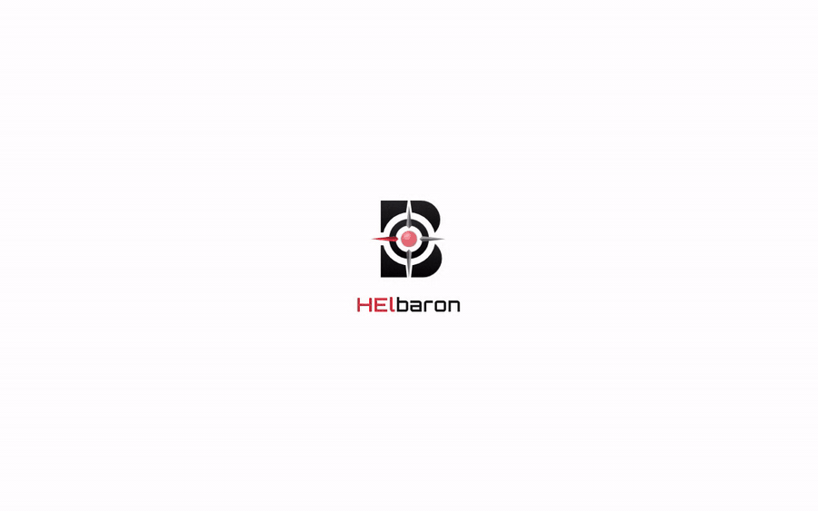
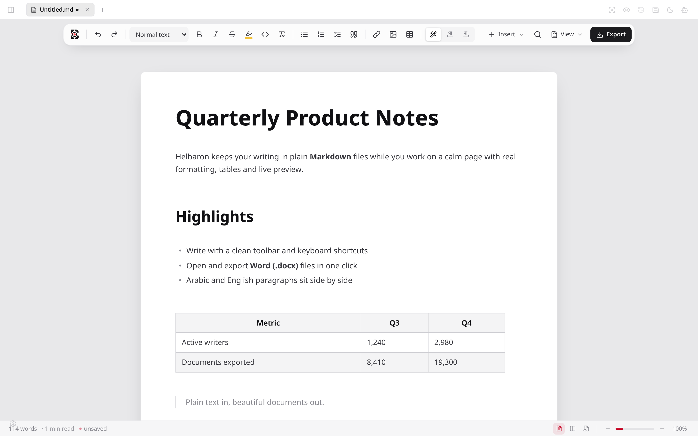
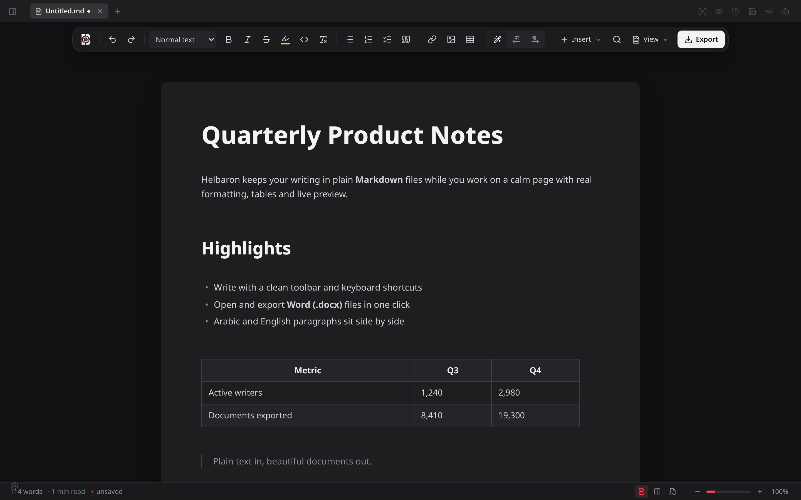
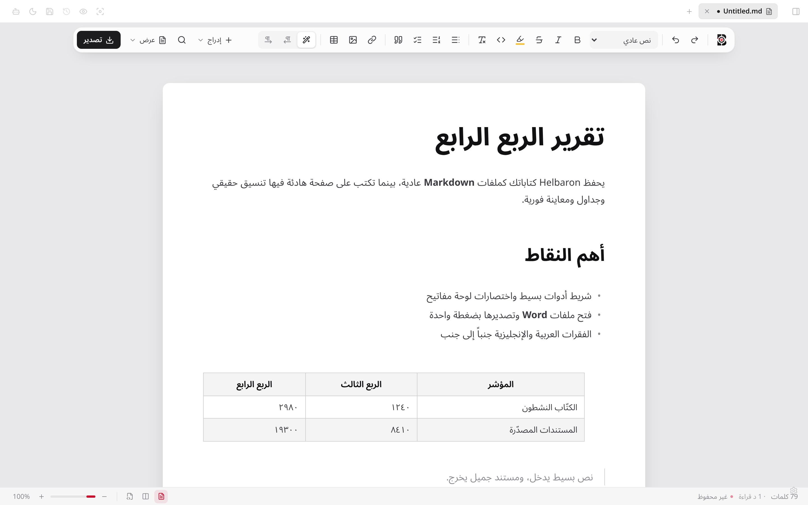
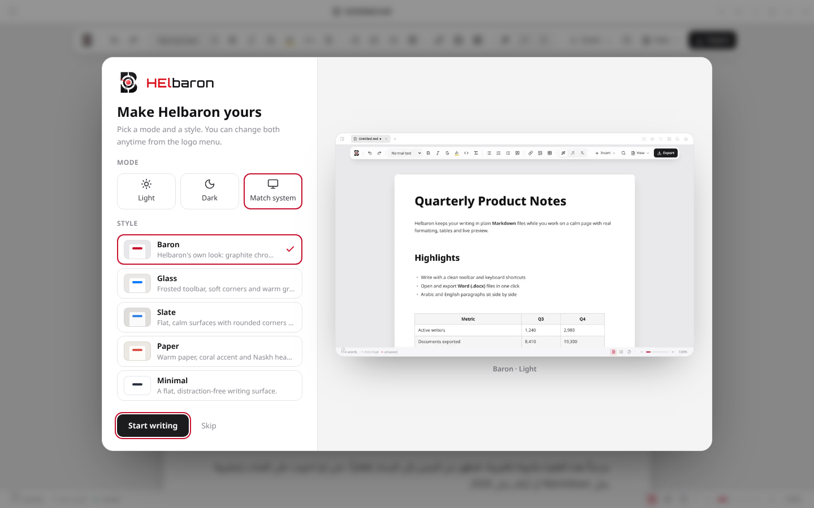
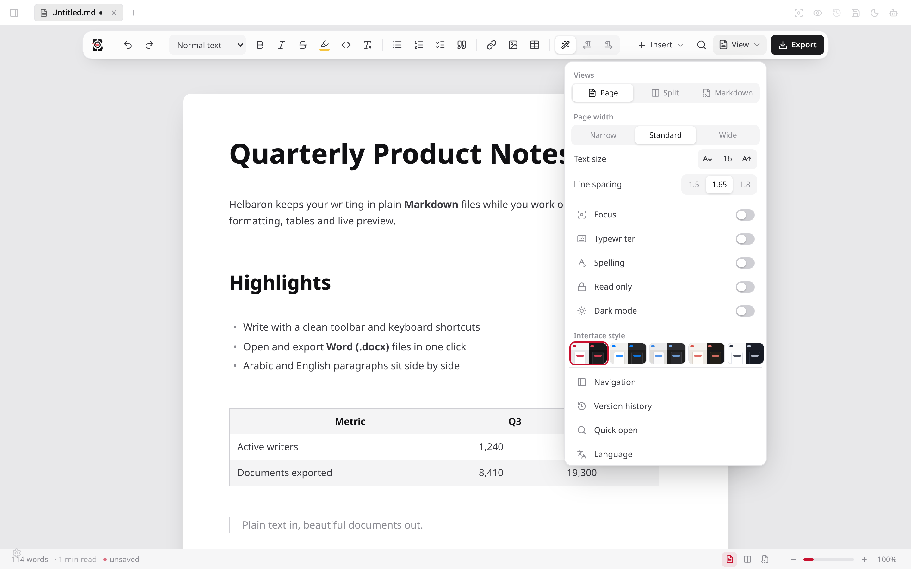
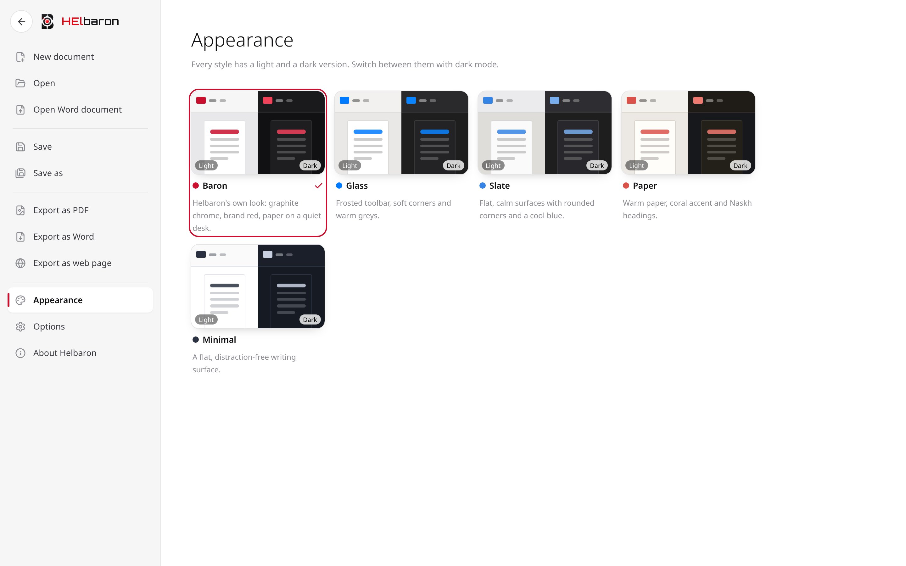

<p align="center">
  
</p>

<h1 align="center">Helbaron</h1>

<p align="center">
  <strong>Write beautifully in Markdown.</strong><br />
  A free, open-source desktop editor with a calm page, real formatting, Word import and export,<br />
  and first-class Arabic and right-to-left writing.
</p>

<p align="center">
  <a href="https://github.com/Hassan-elbaron/helbaron_md/releases/latest"></a>
  <a href="https://github.com/Hassan-elbaron/helbaron_md/releases"></a>
  <a href="https://github.com/Hassan-elbaron/helbaron_md/stargazers"></a>
  
  <a href="LICENSE"></a>
</p>

<p align="center">
  <a href="#download"><strong>Download</strong></a> ·
  <a href="#features">Features</a> ·
  <a href="#screenshots">Screenshots</a> ·
  <a href="#build-from-source">Build from source</a> ·
  <a href="README-AR.md">العربية</a>
</p>

<p align="center">
  
</p>

Helbaron keeps your writing as plain `.md` files on your disk while you work on a page that looks like a finished document: headings, tables, code, math and diagrams render as you type. Open a Word file and keep editing it as Markdown, then export back to `.docx` or PDF when you need to share. Arabic and English sit side by side in the same document, each paragraph finding its own direction without any settings.

No account. No cloud. Your files stay yours.

## Download

| System | Get it |
| --- | --- |
| **Windows 10 / 11** | [`Helbaron_x64-setup.exe`](https://github.com/Hassan-elbaron/helbaron_md/releases/latest) |
| **macOS** (Apple Silicon and Intel) | [`.dmg`](https://github.com/Hassan-elbaron/helbaron_md/releases/latest) |
| **Linux** | [`.AppImage` / `.deb`](https://github.com/Hassan-elbaron/helbaron_md/releases/latest) |

> New apps can trigger a SmartScreen or Gatekeeper notice the first time. On Windows choose **More info → Run anyway**; on macOS right-click the app and choose **Open**.

After installing, Helbaron appears in **Open with** for `.md`, `.markdown`, `.txt` and `.docx` files, and in Windows **Default apps**.

## Features

**A page, not a text box**
- Live preview: headings, lists, tables, images, links, KaTeX math, Mermaid diagrams and callouts render inline; any block opens back to source with a click.
- A single floating toolbar for everyday formatting, with **Insert** and **View** menus for the rest.
- Page, split and Markdown views; focus mode, typewriter mode, adjustable page width, text size and line spacing.

**Word in, Word out**
- Open `.docx` files (from the app or straight from Explorer) and keep editing them as Markdown.
- Export to Word, PDF or a standalone web page. Arabic paragraphs stay right-to-left in exported Word files.

**Arabic and right-to-left, done properly**
- Every paragraph picks its own direction, so mixed Arabic–English documents just work.
- Arabic-tuned typography: proper shaping, no letter-spacing, extra line height for diacritics.
- Search ignores harakat and folds letter variants: `احمد` finds `أحمد`, `مدرسه` finds `مدرسة`.
- A full Arabic interface is one switch away (English by default).

**Make it yours**
- Five interface styles, each with a light and a dark version: **Baron**, **Glass**, **Slate**, **Paper** and **Minimal**. Pick one on first launch with a live preview.
- Custom CSS themes with basic Typora theme compatibility.

**Your files, your machine**
- Plain Markdown files in any folder; file tree, tabs, side-by-side documents, quick open and workspace search.
- Auto-save, version history, local backups and optional WebDAV sync.
- Optional AI writing assistant that works with OpenAI, Anthropic, Gemini, local models and any OpenAI-compatible endpoint. It is off until you add a provider, and every edit is a preview until you accept it.

## Screenshots

<table>
  <tr>
    <td width="50%"></td>
    <td width="50%"></td>
  </tr>
  <tr>
    <td align="center">Baron · light</td>
    <td align="center">Baron · dark</td>
  </tr>
  <tr>
    <td width="50%"></td>
    <td width="50%"></td>
  </tr>
  <tr>
    <td align="center">Arabic document and interface</td>
    <td align="center">Pick your look on first launch</td>
  </tr>
  <tr>
    <td width="50%"></td>
    <td width="50%"></td>
  </tr>
  <tr>
    <td align="center">View menu</td>
    <td align="center">Five styles, light and dark</td>
  </tr>
</table>

## How it compares

| | Helbaron | Typora | Obsidian | MarkText |
| --- | --- | --- | --- | --- |
| Price | Free, open source | Paid after trial | Free, paid add-ons | Free, open source |
| Live preview editing | Yes | Yes | Yes | Yes |
| Word `.docx` import and export built in | **Yes** | Export via Pandoc | Via plugins | No |
| Per-paragraph Arabic / RTL direction | **Yes** | Limited | Limited | Limited |
| Arabic-aware search | **Yes** | No | No | No |
| Interface styles with light and dark | 5 built in | Themes | Themes | Themes |
| Optional AI with edit previews | Yes | No | Via plugins | No |

## Build from source

Requirements: Node.js 24, pnpm 10 and the Rust toolchain ([Tauri prerequisites](https://v2.tauri.app/start/prerequisites/)).

```sh
git clone https://github.com/Hassan-elbaron/helbaron_md.git
cd helbaron_md
pnpm install
pnpm --filter @helbaron/desktop tauri dev     # run the desktop app
pnpm --filter @helbaron/desktop tauri build   # build an installer for your system
pnpm -r test                                  # run the test suites
```

Pushing a tag such as `v2.14.0` builds Windows, macOS and Linux installers on GitHub Actions and publishes them to a release.

## Roadmap

- Signed Windows and notarized macOS builds
- Arabic spellcheck dictionary
- Richer Word fidelity (comments, tracked changes, page setup)
- More export templates

Ideas and bug reports are welcome in [Issues](https://github.com/Hassan-elbaron/helbaron_md/issues).

## Contributing

Pull requests are welcome, from typo fixes to new features. Read [CONTRIBUTING.md](CONTRIBUTING.md) first, and open an issue before large changes.

If Helbaron is useful to you, **a star helps other people find it.** ⭐

## Credits and license

Created by **Hassan Maged Elbaron**.

Helbaron is built on [Markra](https://github.com/markrahq/markra), an open-source Markdown editor, and keeps its copyright notices. The source code is licensed under the [GNU AGPL-3.0](LICENSE).

The Helbaron name, wordmark and compass logo are trademarks of Hassan Maged Elbaron and are not covered by the code license; see [TRADEMARKS.md](TRADEMARKS.md).
